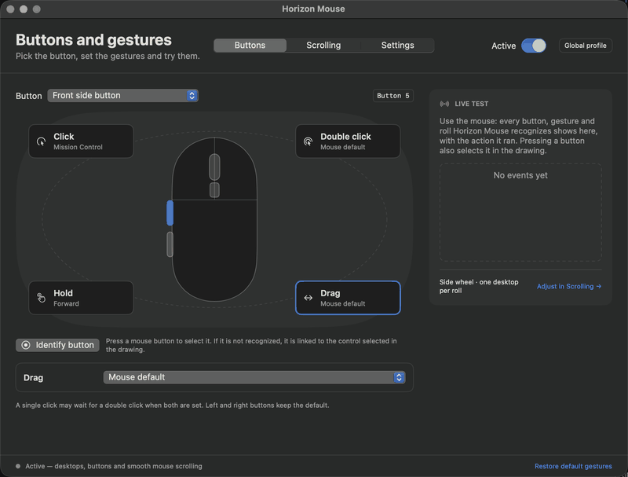
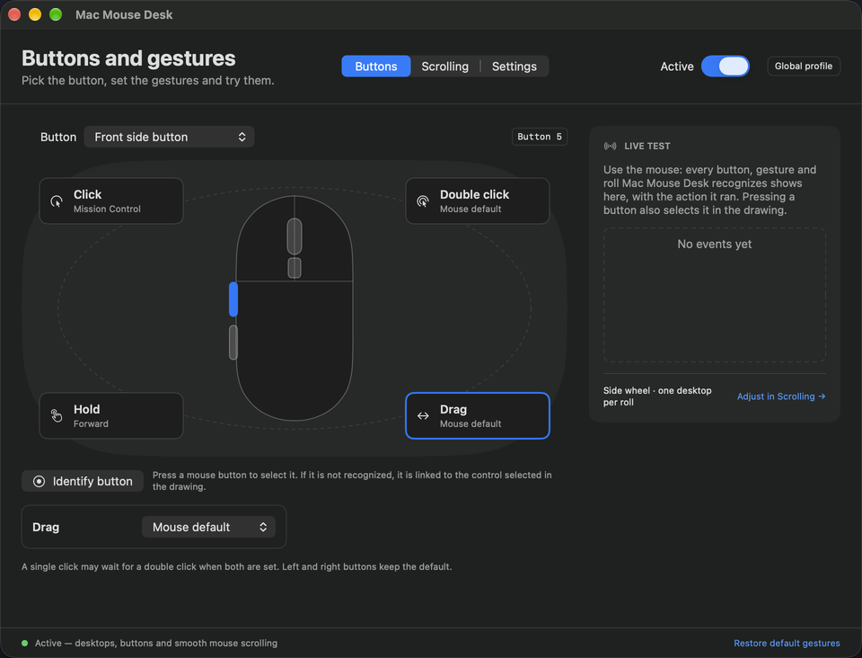

# Horizon Mouse

[](https://github.com/luishscosta/horizon-mouse/actions/workflows/ci.yml)
[](https://github.com/luishscosta/horizon-mouse/actions/workflows/codeql.yml)
[](https://github.com/luishscosta/horizon-mouse/releases/latest)
[](LICENSE)


[](https://github.com/luishscosta/homebrew-tap)

A small macOS menu bar app that gives any wheel mouse button gestures and smooth desktop (Space) switching.



- **Button gestures**: click, double click, hold and drag on each extra button, each with its own action.
- **Desktop switching**: switch Spaces with a side wheel or by dragging a button, animated like a trackpad swipe.
- **Smooth scrolling**: separate vertical and horizontal speeds, plus natural scrolling for the mouse only.
- **Private**: no account, no server, no telemetry, no dependencies. Available in 11 languages: English, Português, Español, Français, Deutsch, Italiano, 日本語, 한국어, 简体中文, Русский and Türkçe.

It works with any mouse, regardless of brand, and never touches the trackpad, the left and right buttons, or other apps' synthetic events.

## Install

Requires macOS 14 or later, on Apple Silicon or Intel (universal binary).

With [Homebrew](https://brew.sh):

```sh
brew trust luishscosta/tap
brew install luishscosta/tap/horizon-mouse
```

Or download `HorizonMouse.dmg` (or `.zip`) from the [latest release](https://github.com/luishscosta/horizon-mouse/releases/latest) and drag the app to **Applications**.

The app is self-signed and **not notarized**, so macOS blocks the first launch. Either remove the quarantine flag:

```sh
xattr -dr com.apple.quarantine "/Applications/Horizon Mouse.app"
```

or open **System Settings → Privacy & Security** and click **Open Anyway**.

## Setup

1. Open the app and grant **Accessibility** access (**Settings → Open Accessibility**). It is required to filter wheel and button events. Releases share one signing certificate, so the grant survives updates.
2. Turn on **Active** at the top of the window.
3. Pause other mouse remappers and vendor apps that bind the same buttons; they compete for the same events.

## Features

### Buttons and gestures



On the **Buttons** tab, pick a control (front side, back side, middle, or the button above the wheel) and set an action for each gesture: **Click**, **Double click**, **Hold** (0.45 s) and **Drag**.

Actions: mouse default, Back (⌘[), Forward (⌘]), a recorded shortcut, Mission Control, Show Desktop, Switch Desktops (Drag only), or nothing.

- Gestures left on *mouse default* pass the original event through untouched.
- With a double click configured, a single click waits 0.3 s to tell them apart.
- While dragging to switch Spaces the pointer stays still, like a trackpad gesture. About 400 points of horizontal motion equal one Space.
- **Identify button** records the next button you press. Some buttons are handled by the mouse firmware (for example a DPI button) and never reach macOS.
- Some mice send a keyboard shortcut instead of a click (for example the middle button sends ⌘Space). To customize one, grant **Input Monitoring**, select the control, use **Identify button** and press it. Only shortcuts coming from the mouse are captured; the same shortcut on the keyboard works as usual.

### Desktop switching and scrolling

- **One desktop per roll** completes a switch on every roll of the side wheel. With it off, **Steps per desktop** sets the sensitivity.
- Holding a chosen key (⌥ by default) turns the side wheel into horizontal scrolling at the **Horizontal speed** (default 10%).
- On the **Scroll** tab, **Vertical speed** (100% = system speed, default 10%), **Acceleration** (off by default; fast spins travel farther), **Smoothness** and **Natural scrolling** apply to the mouse only.

### Settings

**Run in the background** keeps the app active when the window closes, **Show icon in the menu bar** toggles the menu bar item, and **Open at login** uses macOS Login Items. The app language follows the system and can be overridden in **App language**.

## Privacy and trust

- **No network access, no telemetry, no accounts.** Nothing leaves your Mac.
- **Accessibility** is used only to filter mouse wheel and button events. **Input Monitoring** is optional and only lets the app see mouse buttons that send keyboard shortcuts; keystrokes are never recorded or stored.
- No driver or kernel extension. Quit the app and everything returns to normal.
- Small, auditable Swift/C source (MIT) with automated tests and CI. Releases attach `SHA256SUMS.txt`; verify with `shasum -a 256 -c SHA256SUMS.txt`. See [SECURITY.md](SECURITY.md) to verify the signature or report a vulnerability.

## How it works

An event tap filters mouse events. Desktop switching sends the same private Dock gesture a trackpad swipe produces, driven by an exponential smoothing curve, so the animation follows the wheel. Because it uses private macOS APIs, system updates can break it (see [Limitations](#limitations)).

## Troubleshooting

- **"Cannot be opened because the developer cannot be verified":** the app is self-signed, not notarized. Remove the quarantine flag (see [Install](#install)).
- **The app stops capturing the mouse:** re-check **Accessibility** in System Settings → Privacy & Security. Toggle it off and on, then reopen the app.
- **A button is not detected:** use **Identify button**; if it still does nothing, the mouse firmware handles it. Buttons that send a keyboard shortcut need **Input Monitoring**.
- **Conflicts:** quit other remappers and vendor apps that bind the same buttons.

## Build from source

Needs only the Command Line Tools:

```sh
bash scripts/test.sh    # behavior checks, plist validation, translation coverage
bash scripts/build.sh   # produces dist/HorizonMouse.zip and .dmg
```

Install the result in `/Applications` before granting permissions, and avoid building inside a synced folder (it can add metadata that breaks the signature). Without a signing certificate the build falls back to ad-hoc signing and macOS asks for Accessibility again after every build; see [CONTRIBUTING.md](CONTRIBUTING.md).

Diagnostics without capturing input or sending gestures:

```sh
"/Applications/Horizon Mouse.app/Contents/MacOS/HorizonMouse" --diagnose
log stream --predicate 'subsystem == "io.github.luishscosta.horizonmouse"'
```

## Project layout

- `Sources/HorizonMouseApp`: SwiftUI interface, menu bar, login item.
- `Sources/MouseKit`: event filtering, button gestures, smoothing, Space switching.
- `Sources/MouseBridge`: C bridge to the private Dock gesture and HID APIs.
- `Resources/*.lproj`: translations (English strings are the keys).
- `Tests`: XCTest suites, also run as plain asserts by `scripts/test.sh`.

## Limitations

The app relies on private macOS APIs, so system updates can break it.

### Tested hardware

| Mouse | Connection | Mac | macOS | Status |
| --- | --- | --- | --- | --- |
| Rapoo MT760 L | Bluetooth | Apple Silicon (M5) | 27.0.1 | Tested |
| Other wheel mice | any | Apple Silicon | 14 and later | Not tested on hardware |
| Any mouse | any | Intel | 14 to 26 | Builds as a universal binary; not tested on hardware |

Using a different mouse? Please report how it works in an issue, with the `--diagnose` output.

## Uninstall

Turn off **Open at login**, quit the app, delete it from `/Applications`, and remove its entries in Accessibility and Input Monitoring. To clear preferences: `defaults delete io.github.luishscosta.horizonmouse`. No driver or kernel extension is installed.

## Contributing

Issues and pull requests are welcome; see [CONTRIBUTING.md](CONTRIBUTING.md).

## License

[MIT](LICENSE)
